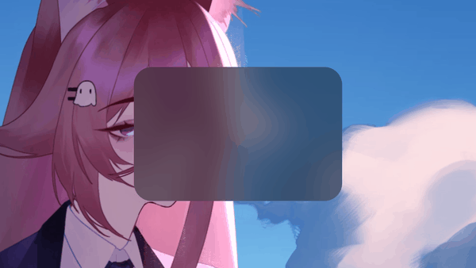

# Haze



Rounded backdrop blur for Windows 10 windows, in Rust.

Windows 10 blurs only whole rectangles behind a window. Put a rounded card in a transparent window and the blur shows square corners around it. Haze draws the blur itself with `Windows.UI.Composition`, so it takes the card's shape. The radius, the strength and the tint can be changed at any time, and the compositor animates the change.

It works with anything that gives you a window handle: Tauri, winit, egui, a plain Win32 window.

## Use

```toml
[dependencies]
haze = "0.2"
```

```rust
use std::time::Duration;
use haze::{Haze, Style};

// On the thread that owns the window. The window has to be transparent.
let haze = Haze::attach(&window, Style::dark().radius(20.0))?;

// Later, from any thread. The compositor runs the animation.
haze.animate_to(Style::light().radius(32.0), Duration::from_millis(300));
haze.fade(false, Duration::from_millis(200));
```

After `attach` the blur follows the window's size and DPI. Nothing needs calling on resize.

The blur belongs to the window. It goes away when the window is destroyed, or when you call `haze.detach()`. A `Haze` is a handle: cloning is cheap, it can be sent to other threads, and dropping it does not remove the blur.

### Tauri

Make the window transparent (`"transparent": true` in `tauri.conf.json`, and a transparent page background), then attach in `setup`, which runs on the main thread:

```rust
.setup(|app| {
    let window = app.get_webview_window("main").unwrap();
    let haze = haze::Haze::attach(&window, haze::Style::dark())?;
    app.manage(haze); // keep it to animate the style later
    Ok(())
})
```

### Without a framework

`Haze::attach_hwnd` takes a raw `HWND`. The example opens a bare Win32 window with nothing in it but the blur:

```
cargo run --example demo
```

The blur changes style every couple of seconds. Drag the window by its body, press Space to fade the blur out and in, D to switch between dark and light, Esc to close.

## Style

```rust
Style::dark()    // graphite tint
Style::light()
Style::frost()   // strong blur, a trace of white
Style::default() // plain blur, no tint

Style::dark().radius(24.0).strength(18.0).tint(0.5).tint_color([10, 10, 14])
```

`radius` is in CSS pixels and is scaled by the window's DPI. `strength` is extra Gaussian blur on top of the system's own. `tint` is how much of `tint_color` lies over the blur, from 0 to 1. A blur over a light backdrop is hard to see without it.

## Other languages

Build `haze.dll` with `cargo build --release --features ffi` to call Haze from C#, Python, an Electron addon or anything else that loads a DLL. The functions are `haze_attach`, `haze_set_style`, `haze_fade`, `haze_detach` and `haze_supported`, declared at the top of `src/ffi.rs`.

## How it works

1. `SetWindowCompositionAttribute` with accent state 5 (`ACCENT_ENABLE_HOSTBACKDROP`) lets a `HostBackdropBrush` see what is behind the window. The call is undocumented.
2. A `Compositor` gets a `DesktopWindowTarget` on the window. It is not topmost, so the window's own content draws over it.
3. One sprite, painted with the `HostBackdropBrush` through a Gaussian blur, is cut to a rounded rectangle with a `CompositionGeometricClip`. A second sprite with a color brush lies over it as the tint, cut the same way.
4. The blur is a small hand-written `IGraphicsEffect` describing `CLSID_D2D1GaussianBlur`, because Win2D does not run in desktop apps. Its amount is a named property, so changing it needs no new effect.
5. The window procedure is replaced with `SetWindowLongPtr` to catch size and DPI changes. `SetWindowSubclass` would need comctl32 v6, which an exe gets only through a manifest.

## Status

- Tested on Windows 10 22H2 (build 19045), over an animated wallpaper. Not tested on other builds or on Windows 11.
- `HostBackdropBrush` needs Windows 10 1803 or newer. `Haze::supported()` tells you whether it is there.
- The Tauri snippet above has not been compiled against a real app.
- Acrylic and blur accents are known to make windows laggy while dragging on 1903 and newer. Haze has not been measured for that.
- A Windows update can break the undocumented call.

## Related

- [window-vibrancy](https://github.com/tauri-apps/window-vibrancy) gives Tauri windows blur, acrylic and mica, rectangular.
- [Win32Acrylic](https://github.com/ALTaleX531/Win32Acrylic) draws acrylic through Composition in C++, over the whole window and without a clip.
- A [Microsoft Q&A thread](https://learn.microsoft.com/en-us/answers/a/152907) on blurring behind a Win32 or WPF window with the Visual Layer.

## License

MIT
